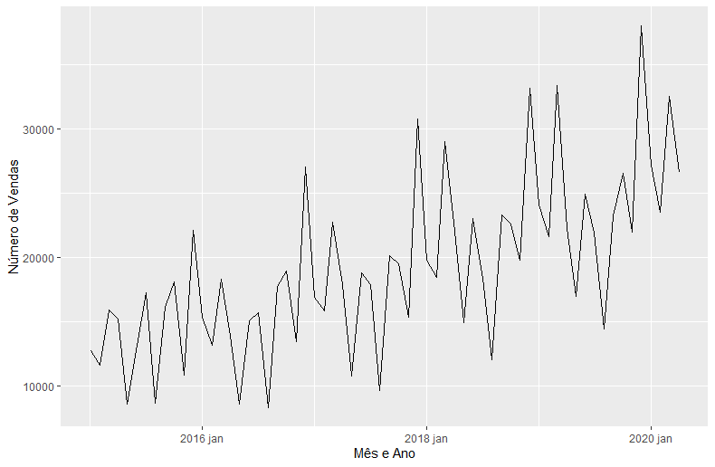

**Data de criação do código:** 19 de março de 2023

# Séries Temporais



Trabalhos de ARIMA/GARCH, clima e Shiny final (ações MSFT/BOVESPA).

## Como executar

Arquivo(s) principal(is): `TrabalhoFinal/Trabalho Final.Rmd`.

```r
# Abra o projeto no RStudio ou, para Shiny:
# setwd(".../Séries Temporais")
# source("main.R")  # quando aplicável
```

## Stack

R, fpp2, rugarch, Shiny, dygraphs

## Estrutura

- Código e notebooks na raiz ou subpastas do diretório do projeto.
- Imagem de capa: `docs/preview.png` (gerada ou copiada de saídas do próprio trabalho).
- Credenciais/dados privados: pasta `secrets/` (ver `SECRETS.md` na raiz do workspace, se existir).

## Licença

Uso acadêmico/pessoal. Ajuste a licença antes de publicar no GitHub.

